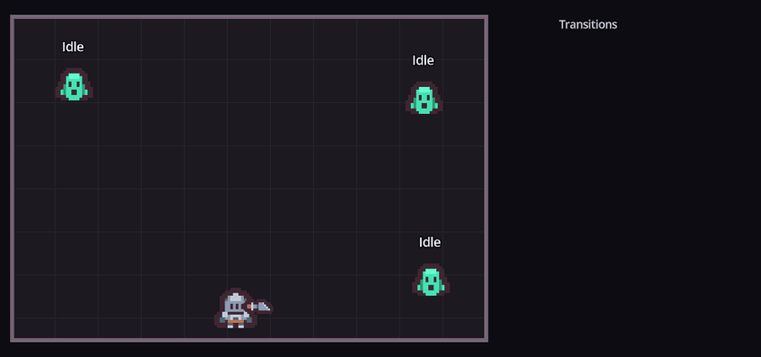
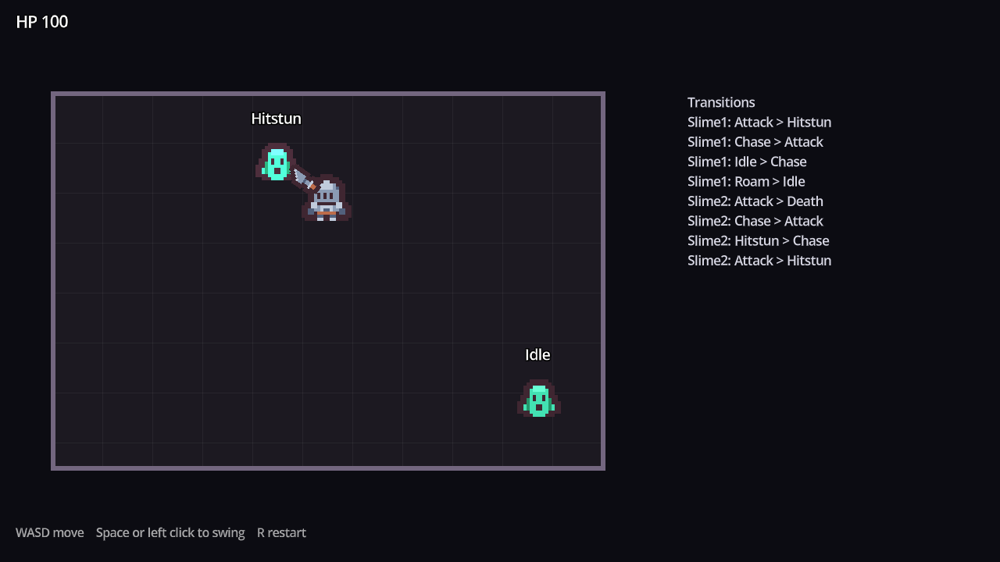

# Godot State Machine

A node-based finite state machine for Godot 4: one node per state, transitions by
signal, and a slime enemy that idles, roams, chases, telegraphs a leap, staggers
when hit and dies.



The label over each slime is its current state; the list on the right is every
transition as it happens.

## Features

- **Two small scripts.** `StateMachine` (about 70 lines) and `State` (about 30)
  are the whole system. Everything else is the demo.
- **One node per state.** Add a child node, attach a script that
  `extends State`, and its node name is its state name. The Scene tree shows the
  whole machine at a glance.
- **Transitions by signal.** A state leaves by emitting
  `transitioned.emit("Chase")`. States never reference each other or the machine,
  so you can add or remove one without touching the rest.
- **Forced transitions from outside.** `change_state("Hitstun")` lets a hit, a
  cutscene or a trigger interrupt whatever the AI was doing.
- **Four hooks per state:** `enter()`, `exit()`, `update(delta)` every frame and
  `physics_update(delta)` every physics frame.
- **A `state_changed(from, to)` signal** for debug labels, logs, analytics or
  animation.
- **A complete enemy to learn from:** six states, NavigationAgent2D chasing, a
  telegraphed leap that only hits on landing, and a vulnerable window after it.

## Demo



Three slimes idle and roam until you come within range. Then they chase you,
crouch and flash red, and leap. Hit one while it is recovering from a leap (it
turns pale blue) for double damage. Dead slimes come back after three seconds.

## Requirements

- Godot **4.7** or later, standard build (GDScript only, no .NET needed).
- Tested on **Godot 4.7.2 stable** on Windows. Earlier 4.x versions are untested.
- Uses the Compatibility renderer, so it runs on older GPUs too.

## Installation

Clone the repository:

```bash
git clone https://github.com/CodingQuests/godot-state-machine.git
```

Or download it with **Code > Download ZIP** and unzip it.

Then open Godot, click **Import**, pick the `project.godot` file inside the folder,
and click **Import & Edit**.

## Quick Start

1. Press **F5**.
2. Move with **WASD**. Swing with **Space** or a left click.
3. Walk toward a slime and watch its label: `Idle` or `Roam`, then `Chase`, then
   `Attack` when it gets close.
4. Step out of the way of the leap, then hit it while it is pale blue.
5. Press **R** to restart.

## How It Works

### The machine

```
Slime (CharacterBody2D)
	StateMachine        initial_state = Idle
		Idle
		Roam
		Chase
		Attack
		Hitstun
		Death
```

On ready, the `StateMachine` gives every `State` child a reference to the node
it drives (`actor`, the machine's parent) and listens to its `transitioned`
signal. Then it enters the initial state and runs the active one:

```gdscript
func _process(delta: float) -> void:
	if current_state:
		current_state.update(delta)


func _physics_process(delta: float) -> void:
	if current_state:
		current_state.physics_update(delta)
```

### A state

Each state checks its own exit conditions and announces where to go next. This
is the whole Idle state:

```gdscript
# Stand still for idle_time, then start roaming.
extends State

@export var idle_time: float = 1.5
var _timer: float = 0.0

func enter() -> void:
	_timer = idle_time
	actor.velocity = Vector2.ZERO

func physics_update(delta: float) -> void:
	if actor.detection.can_see(actor.target):
		transitioned.emit("Chase")
		return
	_timer -= delta
	actor.move_and_slide()
	if _timer <= 0.0:
		transitioned.emit("Roam")
```

### The slime's states

| State | Does | Leaves to |
|---|---|---|
| `Idle` | Stands still for a moment | `Roam` after a timer, `Chase` on sight |
| `Roam` | Walks a random direction | `Idle` after a timer, `Chase` on sight |
| `Chase` | Paths toward the player with `NavigationAgent2D` | `Attack` in range, `Idle` past the leash distance |
| `Attack` | Wind-up (squash, red flash), leap, land, recover (vulnerable) | `Chase` if the player got away, otherwise winds up again |
| `Hitstun` | Staggers while the knockback fades | `Chase` |
| `Death` | Fades out and frees the slime | Nothing: there is no way out |

`Hitstun` and `Death` are never entered by another state. The slime's
`take_hit()` forces them from outside with `state_machine.change_state()`.

### Why the leap is fair

The `Attack` state commits to a direction during the wind-up and only checks for
a hit on the landing frame, so you can always see it coming and step aside. After
landing, the slime is `vulnerable` for a moment, which is your opening.

## Project Structure

```
project.godot                     Project file and input actions
state_machine/StateMachine.gd     The machine
state_machine/State.gd            The base class for states
demo/Main.tscn                    The arena: navigation, three slimes, the player, the log
demo/main.gd                      Demo only: navigation polygon, labels, log, respawns
demo/Slime.tscn                   The slime with its StateMachine and six states
demo/slime.gd                     The slime's body: health, knockback, forcing Hitstun and Death
demo/states/                      Idle, Roam, Chase, Attack, Hitstun, Death
demo/detection.gd                 Distance-based "can I see the player?"
demo/player.gd                    Demo only: movement and a sword swing
assets/kenney_tiny-dungeon/       Kenney Tiny Dungeon sprites (CC0) and their license
```

## Using It In Your Own Game

1. Copy the `state_machine/` folder into your project.
2. Add a `Node` child to your character and attach `StateMachine.gd`.
3. Under it, add one `Node` per state and attach a script that `extends State`.
   The node's name is the state's name.
4. Set `initial_state` on the StateMachine, or leave it empty to start in the
   first child.
5. In each state, use `actor` to reach your character and emit
   `transitioned.emit("OtherState")` to move on.

The same machine works for a player, a door, a boss phase or a menu: `actor` is
whatever node the machine sits under.

## Customizing It

- **Feel:** every state has exported numbers (`idle_time`, `roam_speed`,
  `chase_speed`, `leash_distance`, `attack_range`, `windup_time`, `leap_time`,
  `leap_distance`, `stun_time`). Select a state node and change them in the
  Inspector.
- **Sight:** `detection_radius` in `demo/detection.gd`. Swap in a raycast for line
  of sight.
- **New states:** add a node, attach a new script, and emit `transitioned` into it
  from an existing state.
- **Animation:** connect `state_changed` to an `AnimationPlayer` or
  `AnimationTree` and play the matching animation for each state.

## Known Limitations

- One state at a time. There are no nested (hierarchical) or parallel states.
- Transitions are by node name. A typo in `transitioned.emit("Chsae")` is silently
  ignored, so keep names consistent.
- The demo room is open, so navigation is a single rectangle. Bake a real
  `NavigationPolygon` for levels with walls inside.
- Slimes always know where the player is within range; there is no line of sight.
- Tested on Godot 4.7.2 on Windows only.

## License

MIT for the code. See [LICENSE](LICENSE).

## Third-Party Assets

The knight, sword and slime sprites are from
[Tiny Dungeon](https://kenney.nl/assets/tiny-dungeon) by Kenney, released under
CC0 1.0. Details in [THIRD_PARTY_ASSETS.md](THIRD_PARTY_ASSETS.md), and the pack's
original license is in `assets/kenney_tiny-dungeon/License.txt`.

## Learn How It Works

Want to understand how this works instead of just copying it?

CodingQuests teaches you how to build systems like this step by step in Godot,
with interactive lessons and real projects.

- **[2D Top-Down Enemy AI](https://codingquests.io/quests/2d-enemy-ai?utm_source=github&utm_medium=resource&utm_campaign=godot_state_machine)**
  builds this six-state machine: idle, roam, chase, the telegraphed leap,
  hitstun and death, with NavigationAgent2D pathfinding. The first 2 lessons are
  free.
- **[State Machine AI for 3D Enemies](https://codingquests.io/quests/state-machine-ai?utm_source=github&utm_medium=resource&utm_campaign=godot_state_machine)**
  takes the same idea into 3D. The first 4 lessons are free.

Made by [CodingQuests](https://codingquests.io/?utm_source=github&utm_medium=resource&utm_campaign=godot_state_machine).
